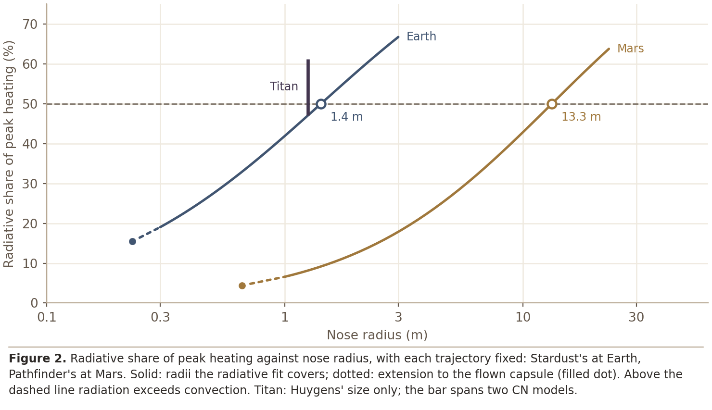
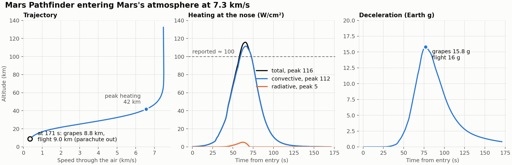
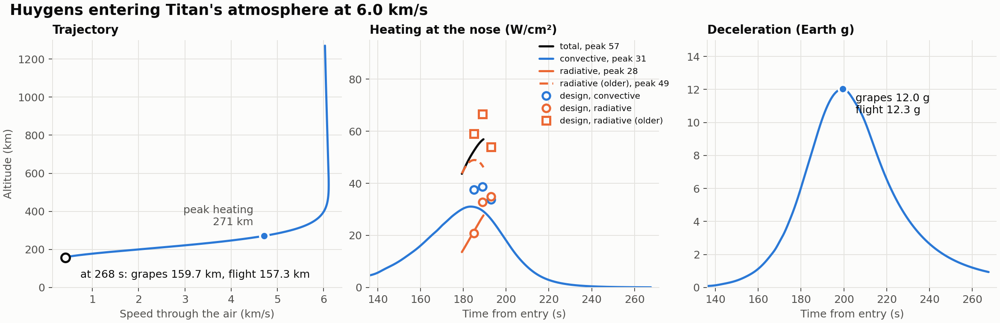

<p align="center"></p>

# grapes

**G**eneral **R**adiation **A**nd **P**lanetary **E**ntry **S**imulator

Entry heating at Earth, Mars and Titan, from a small 2-D simulator checked
against three flown missions.

## Question

When does radiation, rather than convection, set the peak heating at the nose
of an entry capsule?

## Answer

**1. At equal size, Titan radiates like Earth at half the speed.**


| As flown | Entry speed | Nose radius | Radiative share |
|---|---|---|---|
| Stardust, Earth | 12.9 km/s | 0.23 m | 15% |
| Pathfinder, Mars | 7.3 km/s | 0.66 m | 4% |
| Huygens, Titan | 6.0 km/s | 1.25 m | 47–61% |

The capsules differ in size, which matters (finding 2). At Huygens' 1.25 m
nose radius:

| Same size | Entry speed | Radiative share |
|---|---|---|
| Earth, Stardust's trajectory | 12.9 km/s | 47% |
| Mars, Pathfinder's trajectory | 7.3 km/s | 8% |
| Titan, Huygens | 6.0 km/s | 47–61% |

Titan matches or exceeds Earth's radiative share at less than half the speed. Its
nitrogen–methane atmosphere forms CN behind the shock, and CN radiates
strongly. Mars, at a similar speed, radiates little.

**2. Size matters.**



Convective heating falls as 1/√(nose radius); radiative heating rises with it.
On the same trajectory, radiation becomes the larger peak at a nose radius of
about 1.4 m at Earth (Stardust's entry) and 13 m at Mars (Pathfinder's).

**3. At Earth, speed matters too.** For the Stardust capsule at −8.2°, the
share is 15% at 12.9 km/s, 24% at 14 km/s and 37% at 16 km/s.

*Radiative share* = radiative peak ÷ (radiative peak + convective peak). The
two peaks occur a few seconds apart.

## Validation

Each mission starts from its published entry state. No parameter is tuned.


- **Accuracy:** peak deceleration is 1.2–3.3% below flight on all three
  missions, a consistent low bias.
- **Precision:** bars show the central 95% of 400 runs with entry angle
  (σ = 0.05°), entry speed (0.1%), drag coefficient (2%) and density (5%)
  perturbed. These σ values are assumptions.
- Flight lies inside the bar for Pathfinder, at its edge for Stardust and
  outside it for Huygens. Input uncertainty alone does not explain the
  Huygens bias. Two flight values are approximate: Pathfinder's are rounded
  in the source, and Huygens' peak is read from a published plot.

| Mission | Quantity | grapes | Flight |
|---|---|---|---|
| Stardust | Peak deceleration | 31.8 g | 32.9 g |
| | Altitude at 137.9 s | 31.8 km | 31.0 km |
| Pathfinder | Peak deceleration | 15.8 g | 16 g |
| | Altitude at 171 s | 8.8 km | ≈ 9 km |
| Huygens | Peak deceleration | 12.0 g | 12.3 g |
| | Altitude at 267.7 s | 159.7 km | 157.3 km |

Heating was not measured on any of these flights. Against published
estimates:

| Mission | grapes, peak | Published |
|---|---|---|
| Stardust | 838 W/cm² | ≈ 1200 W/cm² (pre-flight design) |
| Pathfinder | 116 W/cm² | ≈ 100 W/cm² |
| Huygens, convective | 31 W/cm² | 34–39 W/cm² (design study) |
| Huygens, radiative | 28–49 W/cm² | 21–67 W/cm² (design study) |

Under the Allen–Eggers assumptions (no gravity, flat planet), the equations
of motion reproduce their closed-form ballistic entry to better than one part
in a million.

<details>
<summary>Entry profiles and corridor maps</summary>






</details>

## Method

- **Flight:** point mass in the entry plane, with drag, gravity, and the
  Coriolis and centrifugal terms of the rotating planet.
- **Atmosphere:** U.S. Standard 1976 at Earth; the profiles measured by
  Pathfinder and Huygens at Mars and Titan.
- **Convective heating:** Sutton–Graves, with the coefficient computed from
  each atmosphere's composition.
- **Radiative heating:** Tauber–Sutton at Earth and Mars. At Titan, a fit to
  three published points for Huygens, bracketed by two CN models.
- **Drag:** constant hypersonic coefficient per capsule.
- **Uncertainty:** Monte Carlo over four inputs (`grapes/dispersion.py`).

## Limits

- The radiative fits are stated to be within about 20% of detailed
  computations. Stardust's and Pathfinder's nose radii sit just below the
  fits' ranges.
- Titan radiative heating covers Huygens' size and 4.7–5.5 km/s only.
- Mars and Titan densities were derived from each probe's own deceleration,
  so their deceleration match is a consistency check, not an independent test.
- Stardust uses the standard atmosphere, not that night's, and an estimated
  entry latitude (42° N).
- Huygens runs without planet rotation, worth at most 17 m/s against a
  6 km/s entry.
- Mass is constant: no ablation.

Not included: 3-D flight, attitude dynamics, Mach-dependent drag.

## Use

```
pip install -r requirements.txt   # exact tested versions
pip install -e .
pytest                            # 69 tests
python examples/showcase.py       # regenerates every figure, about 6 minutes
```

```python
from grapes import simulate
from grapes.cases import STARDUST_ENTRY

traj = simulate(**STARDUST_ENTRY, t_end=140)
print(traj.peak_q_total / 1e4, "W/cm^2")
```

## Sources

Stardust
- Desai, Mitcheltree & Cheatwood, IAF-00-Q.2.04
  ([NTRS 20000109794](https://ntrs.nasa.gov/api/citations/20000109794/downloads/20000109794.pdf))
- Desai & Qualls, "Stardust Entry Reconstruction", AIAA 2008-1198
  ([NTRS 20080008567](https://ntrs.nasa.gov/api/citations/20080008567/downloads/20080008567.pdf))
- Mitcheltree et al., "Aerodynamics of Stardust Sample Return Capsule",
  AIAA 97-2304
  ([NTRS 20040105538](https://ntrs.nasa.gov/api/citations/20040105538/downloads/20040105538.pdf))

Mars Pathfinder
- Braun, Spencer, Kallemeyn & Vaughan, "Mars Pathfinder Atmospheric Entry
  Navigation Operations", AIAA 97-3663 (NASA TM-112885)
- Gnoffo, Weilmuenster, Braun & Cruz, "Effects of Sonic Line Transition on
  Aerothermodynamics of the Mars Pathfinder Probe", AIAA, 1995
- Entry atmosphere profile, NASA PDS
  [MPFL-M-ASIMET-4-DDR-EDL-V1.0](https://pds-atmospheres.nmsu.edu/PDS/data/mpam_0001/edl_ddr/)

Huygens
- Striepe, Blanchard, Kirsch & Fowler, "Huygens Titan Probe Trajectory
  Reconstruction", AAS 07-226
  ([NTRS 20070010747](https://ntrs.nasa.gov/api/citations/20070010747/downloads/20070010747.pdf))
- Johnston, Hollis & Sutton, "Radiative Heating Methodology for the Huygens
  Probe", AIAA 2006-3426
  ([NTRS 20080008445](https://ntrs.nasa.gov/api/citations/20080008445/downloads/20080008445.pdf))
- Kazeminejad, PhD thesis, University of Graz, 2005
  ([ESA archive](https://archives.esac.esa.int/psa/ftp/CASSINI-HUYGENS/DTWG/HP-SSA-DTWG-6-TRAJECTORY-V2.0/DOCUMENT/KAZEMINEJAD_PHD_THESIS.PDF))
- Entry atmosphere profile, NASA PDS
  [HP-SSA-HASI-2-3-4-MISSION-V1.1](https://atmos.nmsu.edu/PDS/data/PDS4/Huygens/hphasi_bundle/DATA/PROFILES/)

Models
- Sutton & Graves, NASA TR R-376, 1971
  ([NTRS 19720003329](https://ntrs.nasa.gov/citations/19720003329))
- Tauber & Sutton, J. Spacecraft and Rockets 28(1), 1991, pp. 40–42
- Allen & Eggers, NACA Report 1381, 1958
- U.S. Standard Atmosphere, 1976

## License

MIT, see [LICENSE](LICENSE).
