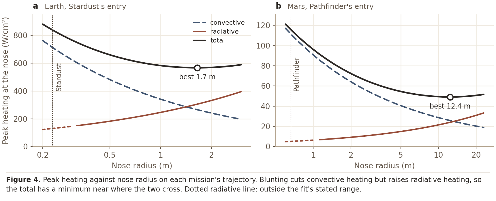
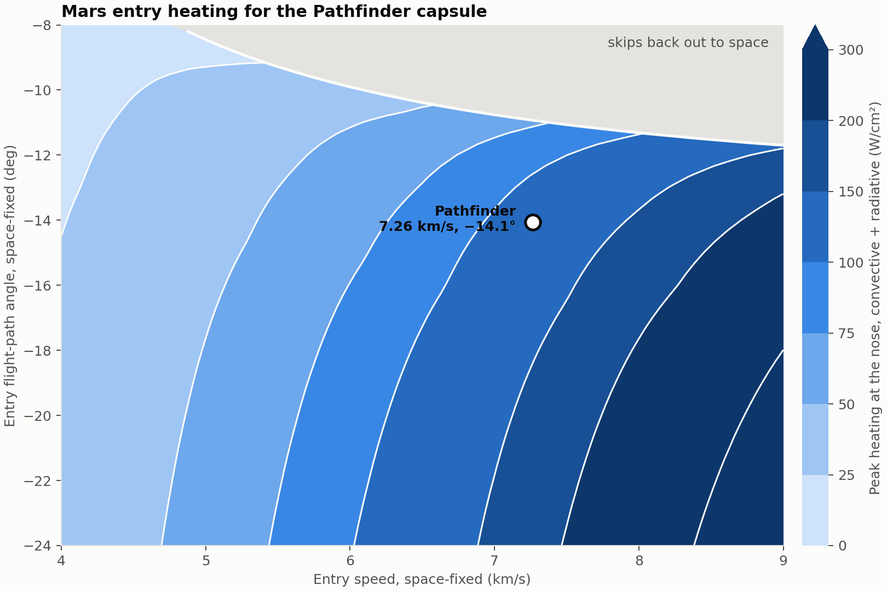

<p align="center"></p>

# grapes

**G**eneral **R**adiation **A**nd **P**lanetary **E**ntry **S**imulator

grapes is a small planetary entry simulator. It flies a capsule through the
atmospheres of Earth, Mars and Titan in two dimensions and computes the
heating at its nose, from both hot-gas conduction and radiation. I built it
to learn how to model a space system end to end: write the physics, check it
against real flights, then use it on a design question:

**For a given entry, how blunt should the nose be?**

## Background

grapes started as coursework: two semesters of graduate Planetary Entry
(AE 598) under Dr. Zachary Putnam, plus an independent study, taken as an
undergraduate. The original course project was a team effort with Chris
Young and Michelle Zosky. This repository is my continuation of that work:
the models, verification against flight data, figures and write-up.

**Skills developed**

- **Flight mechanics:** planar entry equations of motion, with
  rotating-planet (Coriolis and centrifugal) terms and inertial-to-relative
  state conversion
- **Numerical integration:** adaptive Runge–Kutta (scipy's DOP853), with
  events for touchdown and skip-out
- **Atmosphere models:** exponential, U.S. Standard 1976, and spline fits to
  measured Pathfinder and Huygens profiles
- **Aerothermodynamics:** Sutton–Graves convective heating with its
  coefficient computed from gas composition, Tauber–Sutton radiative heating
  at Earth and Mars, and a fitted CN radiation model at Titan
- **Verification and validation:** checks against the Allen–Eggers
  closed-form solution and against Stardust, Pathfinder and Huygens flight
  data
- **Uncertainty:** Monte Carlo dispersion of the entry inputs
- **Design analysis:** entry corridors, skip-out boundaries found by
  bisection, and a nose-radius trade
- **Software:** a tested Python package (69 tests), every input traced to a
  source, reproducible figures

## Convective and Radiative Heating

Stagnation-point heat flux, with freestream density $\rho$, speed $V$ and
nose radius $R_n$, in SI units:

$$q_c = k\sqrt{\frac{\rho}{R_n}}\,V^3 \qquad \text{convective (Sutton–Graves)}$$

$$q_r = C\,R_n^{\,a}\,\rho^{\,b}\,f(V) \qquad \text{radiative (Tauber–Sutton)}$$

$k$, $C$, $a$, $b$ and the tabulated $f(V)$ depend on the gas. At Earth,
$b = 1.22$, $a \le 1$, and $f(V)$ grows about as $V^7$ from 11 to 16 km/s;
at Mars, $a = 0.53$ and $b = 1.19$. Titan uses a fit to three published
points. Dividing the two:

$$\frac{q_r}{q_c} \propto R_n^{\,a + 1/2}\,\rho^{\,b - 1/2}\,\frac{f(V)}{V^3}$$

Radiation gains on convection with nose radius, density and speed.

## Model Verification

Each mission starts from its published entry state. No parameter is tuned.


Peak deceleration lands 1.2–3.3% below flight on all three missions, a small
consistent bias. Late-entry altitude is within the input-uncertainty spread
for all three. Heating was never measured in flight. Against published
estimates the model is within 20% for Pathfinder and Huygens, and 30% below
Stardust's pre-flight design value (Details).

## Radiative Heating Fraction

On each probe's real trajectory and nose:


Huygens, the slowest entry, has the largest radiative share. Part of that is
size: its nose is more than five times Stardust's. At the same 1.25 m nose,
Earth on Stardust's trajectory reaches 47% and Mars 8%, so Titan at 6 km/s
matches Earth at 12.9 km/s. Titan's nitrogen–methane atmosphere forms CN
behind the shock, and CN radiates strongly.

## Where radiation takes over


| | Radiation = convection at |
|---|---|
| Earth, 12 → 16 km/s | 2.4 m → 0.44 m nose radius |
| Mars, 7 → 9 km/s | 18 m → 5.5 m |
| Titan, 6 km/s | Huygens' own 1.25 m |

## How blunt should the nose be?



Blunt until radiative heating matches convective heating, then stop. A
blunter nose lowers convective heating and raises radiative heating, so total
peak heating is lowest close to the nose radius where the two are equal.

- **Earth, on Stardust's entry:** about 1.7 m, with 32% less peak heating
  than the 0.23 m it flew. At 16 km/s the answer drops below 0.5 m.
- **Mars:** as blunt as the aeroshell allows. The crossover is 5–18 m,
  larger than any flown, so convection sets the design.
- **Titan:** about Huygens' own 1.25 m, which already sits at the crossover.

Trajectory, mass and drag area are held fixed; only the nose radius changes.

## Details

<details>
<summary>Heating against published estimates</summary>

| Mission | grapes, peak | Published |
|---|---|---|
| Stardust | 838 W/cm² | ≈ 1200 W/cm² (pre-flight design) |
| Pathfinder | 116 W/cm² | ≈ 100 W/cm² |
| Huygens, convective | 31 W/cm² | 34–39 W/cm² (design study) |
| Huygens, radiative | 28–49 W/cm² | 21–67 W/cm² (design study) |

</details>

<details>
<summary>Entry profiles and corridor maps</summary>




</details>

<details>
<summary>Method</summary>

- **Flight:** point mass in the entry plane, with drag, gravity, and the
  Coriolis and centrifugal terms of the rotating planet.
- **Atmosphere:** U.S. Standard 1976 at Earth; the profiles measured by
  Pathfinder and Huygens at Mars and Titan.
- **Convective heating:** Sutton–Graves, with the coefficient computed from
  each atmosphere's composition.
- **Radiative heating:** Tauber–Sutton at Earth and Mars. At Titan, a fit to
  three published points for Huygens, bracketed by two CN models.
- **Drag:** constant hypersonic coefficient per capsule.
- **Uncertainty:** Monte Carlo over four inputs (`grapes/dispersion.py`).
- **Verification:** under the Allen–Eggers assumptions (no gravity, flat
  planet) the equations of motion reproduce their closed-form ballistic entry
  to better than one part in a million.

</details>

<details>
<summary>Limits</summary>

- The radiative fits are stated to be within about 20% of detailed
  computations. Stardust's and Pathfinder's nose radii sit just below the
  fits' ranges.
- Titan radiative heating covers Huygens' size and 4.7–5.5 km/s only.
- Mars and Titan densities were derived from each probe's own deceleration,
  so their deceleration match is a consistency check, not an independent test.
- Two flight values are approximate: Pathfinder's are rounded in the source,
  and Huygens' peak deceleration is read from a published plot.
- Stardust uses the standard atmosphere, not that night's, and an estimated
  entry latitude (42° N).
- Huygens runs without planet rotation, worth at most 17 m/s against a
  6 km/s entry.
- Mass is constant: no ablation. No 3-D flight, attitude dynamics or
  Mach-dependent drag.

</details>

<details>
<summary>References</summary>

**Stardust**

1. Desai, P. N., Mitcheltree, R. A., and Cheatwood, F. M., "Sample Returns
   Missions in the Coming Decade," IAF Paper 00-Q.2.04, 51st International
   Astronautical Congress, Rio de Janeiro, 2000.
   [NTRS 20000109794](https://ntrs.nasa.gov/citations/20000109794)
2. Desai, P. N., and Qualls, G. D., "Stardust Entry Reconstruction,"
   AIAA Paper 2008-1198, 2008.
   [NTRS 20080008567](https://ntrs.nasa.gov/citations/20080008567)
3. Mitcheltree, R. A., Wilmoth, R. G., Cheatwood, F. M., Brauckmann, G. J.,
   and Greene, F. A., "Aerodynamics of Stardust Sample Return Capsule,"
   AIAA Paper 97-2304, 1997.
   [NTRS 20040105538](https://ntrs.nasa.gov/citations/20040105538)

**Mars Pathfinder**

4. Braun, R. D., Spencer, D. A., Kallemeyn, P. H., and Vaughan, R. M.,
   "Mars Pathfinder Atmospheric Entry Navigation Operations,"
   AIAA Paper 97-3663, 1997 (NASA TM-112885).
5. Gnoffo, P. A., Weilmuenster, K. J., Braun, R. D., and Cruz, C. I.,
   "Effects of Sonic Line Transition on Aerothermodynamics of the Mars
   Pathfinder Probe," AIAA Paper, 1995.
6. Mars Pathfinder ASI/MET entry atmosphere profile,
   MPFL-M-ASIMET-4-DDR-EDL-V1.0, NASA Planetary Data System.
   [PDS](https://pds-atmospheres.nmsu.edu/PDS/data/mpam_0001/edl_ddr/)

**Huygens**

7. Striepe, S. A., Blanchard, R. C., Kirsch, M. F., and Fowler, W. T.,
   "Huygens Titan Probe Trajectory Reconstruction Using Traditional Methods
   and the Program to Optimize Simulated Trajectories II," AAS Paper 07-226,
   17th AAS/AIAA Space Flight Mechanics Meeting, Sedona, AZ, 2007.
   [NTRS 20070010747](https://ntrs.nasa.gov/citations/20070010747)
8. Johnston, C. O., Hollis, B. R., and Sutton, K., "Radiative Heating
   Methodology for the Huygens Probe," AIAA Paper 2006-3426, 2006.
   [NTRS 20080008445](https://ntrs.nasa.gov/citations/20080008445)
9. Kazeminejad, B., PhD thesis, University of Graz, 2005.
   [ESA archive](https://archives.esac.esa.int/psa/ftp/CASSINI-HUYGENS/DTWG/HP-SSA-DTWG-6-TRAJECTORY-V2.0/DOCUMENT/KAZEMINEJAD_PHD_THESIS.PDF)
10. Huygens HASI entry atmosphere profile, HP-SSA-HASI-2-3-4-MISSION-V1.1,
    NASA Planetary Data System.
    [PDS](https://atmos.nmsu.edu/PDS/data/PDS4/Huygens/hphasi_bundle/DATA/PROFILES/)

**Models**

11. Sutton, K., and Graves, R. A., "A General Stagnation-Point
    Convective-Heating Equation for Arbitrary Gas Mixtures," NASA TR R-376,
    1971. [NTRS 19720003329](https://ntrs.nasa.gov/citations/19720003329)
12. Tauber, M. E., and Sutton, K., "Stagnation-Point Radiative Heating
    Relations for Earth and Mars Entries," Journal of Spacecraft and Rockets,
    Vol. 28, No. 1, 1991, pp. 40–42.
13. Allen, H. J., and Eggers, A. J., "A Study of the Motion and Aerodynamic
    Heating of Ballistic Missiles Entering the Earth's Atmosphere at High
    Supersonic Speeds," NACA Report 1381, 1958.
14. U.S. Standard Atmosphere, 1976, NOAA, NASA and USAF, Washington, DC, 1976.

</details>

## Use

```
pip install -r requirements.txt   # exact tested versions
pip install -e .
pytest                            # 69 tests
python examples/showcase.py       # regenerates every figure, about 8 minutes
```

```python
from grapes import simulate
from grapes.cases import STARDUST_ENTRY

traj = simulate(**STARDUST_ENTRY, t_end=140)
print(traj.peak_q_total / 1e4, "W/cm^2")
```

## License

MIT, see [LICENSE](LICENSE).
