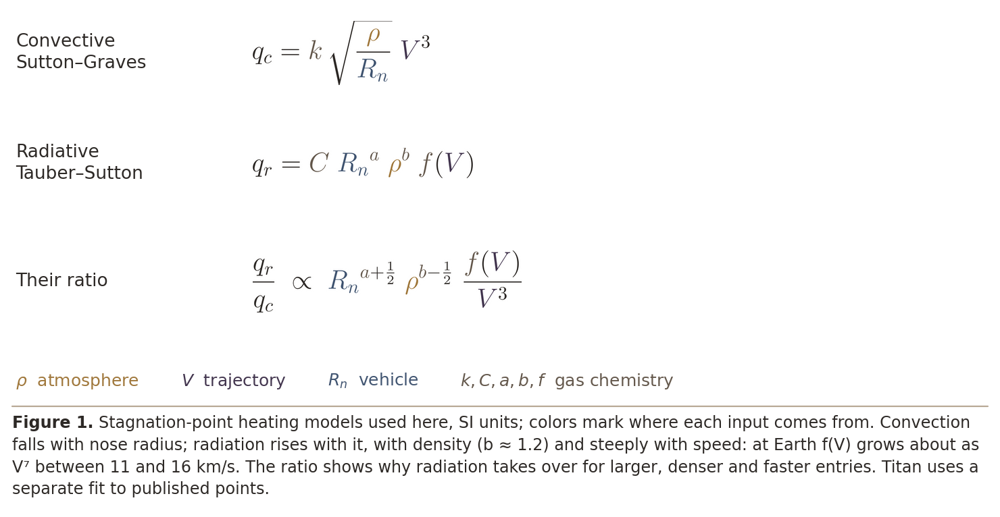
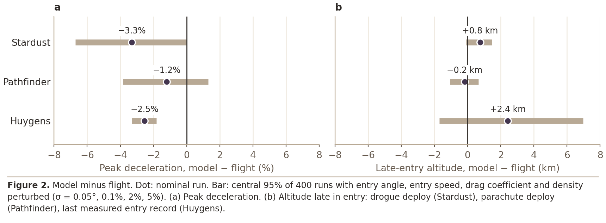
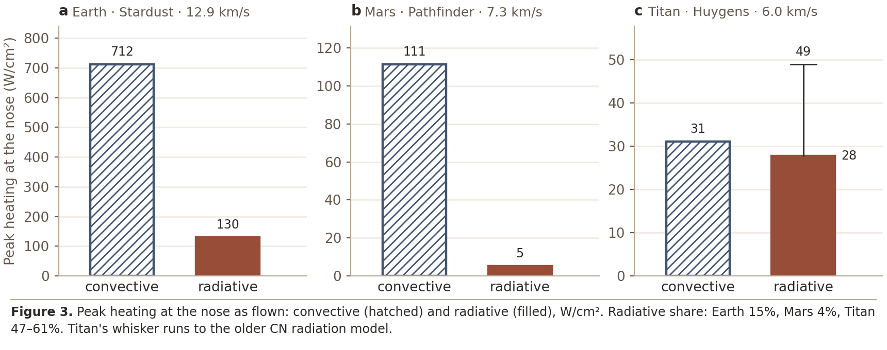
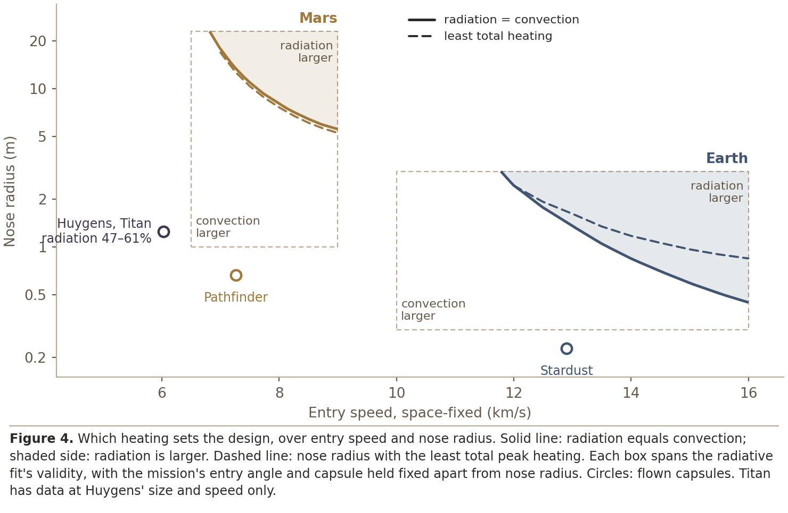
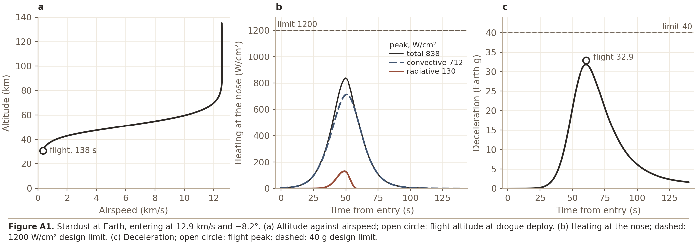
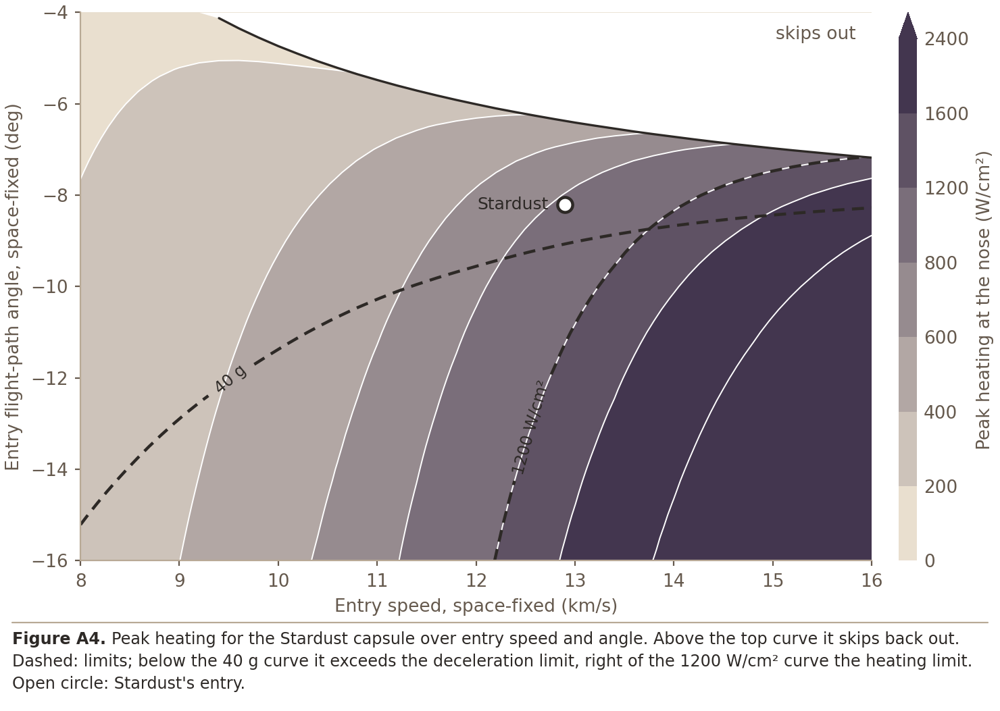

<p align="center"></p>

# grapes

**G**eneral **R**adiation **A**nd **P**lanetary **E**ntry **S**imulator

A capsule entering an atmosphere is heated at its nose in two ways: hot gas
conducts heat into the wall (convective heating), and hot gas glows
(radiative heating). This project asks a design question: **when does
radiation, rather than convection, set the heatshield?** It answers with a
small 2-D entry simulator, checked against three flown missions.

## Two heating laws



Convection falls with nose radius; radiation rises with it, and climbs much
faster with speed. Their ratio is the whole story: larger, faster and denser
entries tilt toward radiation.

## Is the model right?

Each mission starts from its published entry state. No parameter is tuned.



Peak deceleration lands 1.2–3.3% below flight on all three missions, a small
consistent bias. Late-entry altitude is within the input-uncertainty spread
for all three. Heating was never measured in flight. Against published
estimates the model is within 20% for Pathfinder and Huygens, and 30% below
Stardust's pre-flight design value (Details).

## As flown



Huygens, the slowest entry, has the largest radiative share. Part of that is
size: its nose is more than five times Stardust's. At the same 1.25 m nose, Earth on
Stardust's trajectory reaches 47% and Mars 8%. **Titan matches Earth at half
the speed**: its nitrogen–methane air forms CN behind the shock, a strong
radiator.

## Where radiation takes over



| | Radiation = convection at |
|---|---|
| Earth, 12 → 16 km/s | 2.4 m → 0.44 m nose radius |
| Mars, 7 → 9 km/s | 18 m → 5.5 m |
| Titan, 6 km/s | Huygens' own 1.25 m |

## Engineering takeaway


**Blunt the nose until radiation takes over, then stop.** A blunter nose
cuts convective heating but adds radiative heating, so total peak heating
has a minimum close to the crossover.

- **Earth sample return:** on Stardust's entry the best nose is 1.7 m, with
  32% less peak heating than the flown 0.23 m. At 16 km/s the crossover drops
  below half a metre, so fast returns must be sized for radiation.
- **Mars:** the crossover sits at 5–18 m, beyond any flown aeroshell.
  Convection sizes Mars heatshields; radiation is a margin.
- **Titan:** Huygens already sits at the crossover. The disagreement between
  CN radiation models (47–61%) is itself a design driver.

These trades hold the trajectory, mass and drag area fixed and change only
the nose radius.

## Details

<details>
<summary>Heating against published estimates</summary>

| Mission | grapes, peak | Published |
|---|---|---|
| Stardust | 838 W/cm² | ≈ 1200 W/cm² (pre-flight design) |
| Pathfinder | 116 W/cm² | ≈ 100 W/cm² |
| Huygens, convective | 31 W/cm² | 34–39 W/cm² (design study) |
| Huygens, radiative | 28–49 W/cm² | 21–67 W/cm² (design study) |

</details>

<details>
<summary>Entry profiles and corridor maps</summary>







</details>

<details>
<summary>Method</summary>

- **Flight:** point mass in the entry plane, with drag, gravity, and the
  Coriolis and centrifugal terms of the rotating planet.
- **Atmosphere:** U.S. Standard 1976 at Earth; the profiles measured by
  Pathfinder and Huygens at Mars and Titan.
- **Convective heating:** Sutton–Graves, with the coefficient computed from
  each atmosphere's composition.
- **Radiative heating:** Tauber–Sutton at Earth and Mars. At Titan, a fit to
  three published points for Huygens, bracketed by two CN models.
- **Drag:** constant hypersonic coefficient per capsule.
- **Uncertainty:** Monte Carlo over four inputs (`grapes/dispersion.py`).
- **Verification:** under the Allen–Eggers assumptions (no gravity, flat
  planet) the equations of motion reproduce their closed-form ballistic entry
  to better than one part in a million.

</details>

<details>
<summary>Limits</summary>

- The radiative fits are stated to be within about 20% of detailed
  computations. Stardust's and Pathfinder's nose radii sit just below the
  fits' ranges.
- Titan radiative heating covers Huygens' size and 4.7–5.5 km/s only.
- Mars and Titan densities were derived from each probe's own deceleration,
  so their deceleration match is a consistency check, not an independent test.
- Two flight values are approximate: Pathfinder's are rounded in the source,
  and Huygens' peak deceleration is read from a published plot.
- Stardust uses the standard atmosphere, not that night's, and an estimated
  entry latitude (42° N).
- Huygens runs without planet rotation, worth at most 17 m/s against a
  6 km/s entry.
- Mass is constant: no ablation. No 3-D flight, attitude dynamics or
  Mach-dependent drag.

</details>

## Use

```
pip install -r requirements.txt   # exact tested versions
pip install -e .
pytest                            # 69 tests
python examples/showcase.py       # all figures but Figure 1, about 8 minutes
python examples/equations.py      # Figure 1; needs LaTeX with dvipng
```

```python
from grapes import simulate
from grapes.cases import STARDUST_ENTRY

traj = simulate(**STARDUST_ENTRY, t_end=140)
print(traj.peak_q_total / 1e4, "W/cm^2")
```

## Sources

Stardust
- Desai, Mitcheltree & Cheatwood, IAF-00-Q.2.04
  ([NTRS 20000109794](https://ntrs.nasa.gov/api/citations/20000109794/downloads/20000109794.pdf))
- Desai & Qualls, "Stardust Entry Reconstruction", AIAA 2008-1198
  ([NTRS 20080008567](https://ntrs.nasa.gov/api/citations/20080008567/downloads/20080008567.pdf))
- Mitcheltree et al., "Aerodynamics of Stardust Sample Return Capsule",
  AIAA 97-2304
  ([NTRS 20040105538](https://ntrs.nasa.gov/api/citations/20040105538/downloads/20040105538.pdf))

Mars Pathfinder
- Braun, Spencer, Kallemeyn & Vaughan, "Mars Pathfinder Atmospheric Entry
  Navigation Operations", AIAA 97-3663 (NASA TM-112885)
- Gnoffo, Weilmuenster, Braun & Cruz, "Effects of Sonic Line Transition on
  Aerothermodynamics of the Mars Pathfinder Probe", AIAA, 1995
- Entry atmosphere profile, NASA PDS
  [MPFL-M-ASIMET-4-DDR-EDL-V1.0](https://pds-atmospheres.nmsu.edu/PDS/data/mpam_0001/edl_ddr/)

Huygens
- Striepe, Blanchard, Kirsch & Fowler, "Huygens Titan Probe Trajectory
  Reconstruction", AAS 07-226
  ([NTRS 20070010747](https://ntrs.nasa.gov/api/citations/20070010747/downloads/20070010747.pdf))
- Johnston, Hollis & Sutton, "Radiative Heating Methodology for the Huygens
  Probe", AIAA 2006-3426
  ([NTRS 20080008445](https://ntrs.nasa.gov/api/citations/20080008445/downloads/20080008445.pdf))
- Kazeminejad, PhD thesis, University of Graz, 2005
  ([ESA archive](https://archives.esac.esa.int/psa/ftp/CASSINI-HUYGENS/DTWG/HP-SSA-DTWG-6-TRAJECTORY-V2.0/DOCUMENT/KAZEMINEJAD_PHD_THESIS.PDF))
- Entry atmosphere profile, NASA PDS
  [HP-SSA-HASI-2-3-4-MISSION-V1.1](https://atmos.nmsu.edu/PDS/data/PDS4/Huygens/hphasi_bundle/DATA/PROFILES/)

Models
- Sutton & Graves, NASA TR R-376, 1971
  ([NTRS 19720003329](https://ntrs.nasa.gov/citations/19720003329))
- Tauber & Sutton, J. Spacecraft and Rockets 28(1), 1991, pp. 40–42
- Allen & Eggers, NACA Report 1381, 1958
- U.S. Standard Atmosphere, 1976

## License

MIT, see [LICENSE](LICENSE).
